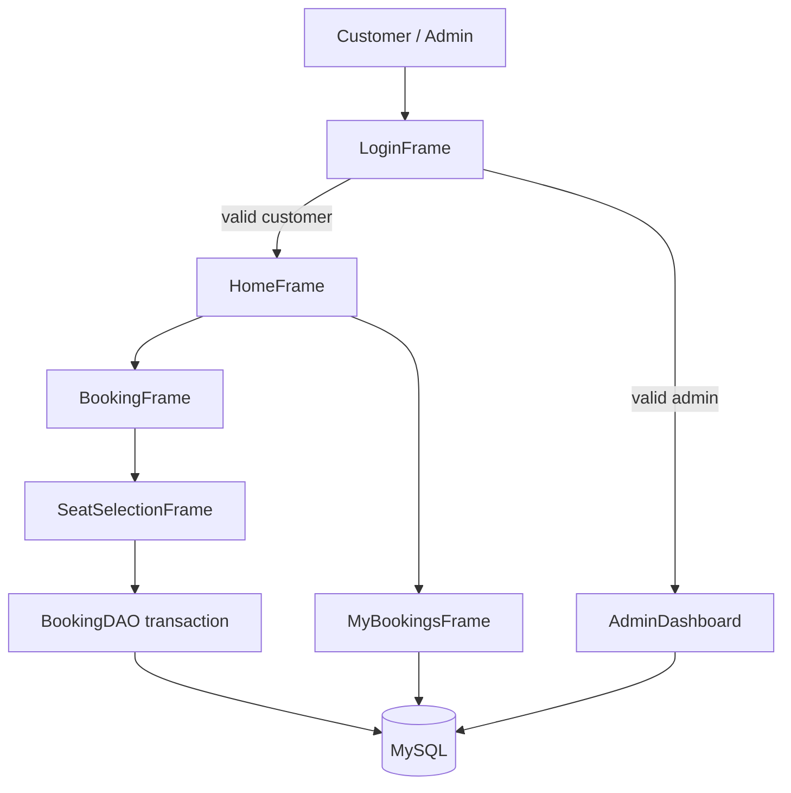
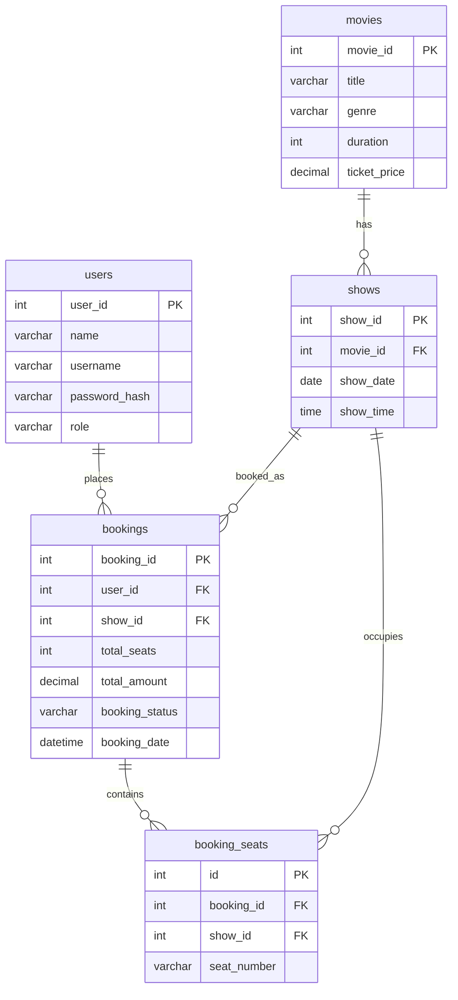

# CineBook - Cinema Ticket Booking System

CineBook is a Java desktop application for booking cinema tickets. A customer can view movies, pick a show, choose seats, and save a simple ticket file. An administrator can manage movies and view bookings.

This project was built for the **Advanced Java** subject using Swing, JDBC, and MySQL.

---

## 1. Project Introduction

Buying cinema tickets on paper is slow and it is easy to book the same seat twice. CineBook stores movies, shows, seats, and bookings in MySQL. The Java Swing screens let a student demonstrate GUI programming, event handling, JDBC, and basic collections.

---

## 2. Objectives

- Build a working desktop ticket-booking application.
- Use Java Swing and AWT for the user interface.
- Connect the application to MySQL with JDBC and `PreparedStatement`.
- Stop two customers from booking the same seat for the same show.
- Separate customer and administrator login.
- Store password hashes instead of plain-text passwords.

---

## 3. Problem Statement

A cinema needs a simple computer system where customers can see movies, select a date and time, choose seats, and confirm a booking. The cinema staff also need a way to add or update movies and look at all bookings. The system should keep seat records correctly and should not crash when the user enters invalid data.

---

## 4. Project Scope

**In scope**

- Customer registration and login
- Movie list and search
- Show date/time selection
- Seat layout and booking confirmation
- Save ticket details to a text file
- View and cancel bookings
- Admin movie management and booking summary

**Out of scope**

- Online payment gateways
- Real movie APIs
- Mobile app or website
- Multi-screen cinema maps
- Email or SMS tickets

---

## 5. Features

**Customer**

- Login and register
- View movies (name, genre, duration, price)
- Filter movies by typing in the search box
- Book tickets for a selected show
- Colour-coded seats (green = free, blue = selected, red = booked)
- Confirmation with booking ID, seats, and total price
- My Bookings list and cancellation

**Administrator**

- Add, update, and delete movies
- View all bookings
- View total confirmed bookings and total ticket sales
- Logout

---

## 6. Technologies Used

| Item | Choice |
|------|--------|
| Language | Java |
| GUI | Java Swing and AWT |
| Database | MySQL 8.4 |
| Connectivity | JDBC (`mysql-connector-j-9.3.0`) |
| IDE | Visual Studio Code or Eclipse |
| Collections | `TreeSet` for selected seats, `LinkedList` for movie/booking lists |

No Spring Boot, no React, and no extra GUI libraries.

---

## 7. Software Requirements

- Windows 10 or later
- JDK 17 or later (tested with JDK 27)
- MySQL Server 8.0 or 8.4
- MySQL Workbench (optional, useful for running the SQL script)
- Visual Studio Code with the Extension Pack for Java, or Eclipse

---

## 8. System Requirements

**Hardware (student PC)**

- 4 GB RAM or more
- About 200 MB free disk space

**Software**

- JDK on the PATH (`java` and `javac` should work in Command Prompt)
- MySQL service running (`MySQL84` on this project machine)

---

## 9. Folder Structure

```
java project/
├── src/cinema/Main.java
├── src/cinema/model/     User, Movie, Show, Booking
├── src/cinema/dao/       UserDAO, MovieDAO, ShowDAO, BookingDAO
├── src/cinema/ui/        Login, Register, Home, Booking, Seats, MyBookings, Admin
├── src/cinema/util/      DBConnection, PasswordUtil, UITheme
├── database/cinema_booking.sql
├── lib/mysql-connector-j-9.3.0.jar
├── docs/PROJECT_REPORT.md
├── db.properties.example
├── compile.bat
├── run.bat
├── setup_database.bat
└── README.md
```

---

## 10. Database Setup Instructions

1. Start MySQL.
2. Open MySQL Workbench or MySQL Command Line Client.
3. Login as `root` (or another user that can create databases).
4. Open and run `database/cinema_booking.sql`.

Or from Command Prompt in the project folder:

```bat
setup_database.bat
```

This creates database `cinebook`, five tables, sample movies, sample shows, and two demo users.

---

## 11. Steps to Configure JDBC

1. Copy `db.properties.example` to `db.properties` in the project root.
2. Edit the file:

```properties
db.url=jdbc:mysql://localhost:3306/cinebook?useSSL=false&allowPublicKeyRetrieval=true&serverTimezone=UTC
db.user=root
db.password=YOUR_MYSQL_PASSWORD
```

3. Save the file. `db.properties` is listed in `.gitignore` so the password is not committed.

You can also set environment variables instead of the file:

- `CINEBOOK_DB_URL`
- `CINEBOOK_DB_USER`
- `CINEBOOK_DB_PASSWORD`

`DBConnection.java` reads environment variables first, then `db.properties`.

---

## 12. How to Compile and Run

Open Command Prompt in the project folder.

```bat
compile.bat
run.bat
```

Manual commands:

```bat
javac -encoding UTF-8 -cp "lib\mysql-connector-j-9.3.0.jar" -d bin src\cinema\*.java src\cinema\model\*.java src\cinema\dao\*.java src\cinema\ui\*.java src\cinema\util\*.java

java -cp "bin;lib\mysql-connector-j-9.3.0.jar" cinema.Main
```

In VS Code, open the folder and run `cinema.Main`.

---

## 13. Sample Login Instructions

These accounts are created by the SQL script. Passwords are stored as SHA-256 hashes, not as plain text in Java source files.

| Role | Username | Password |
|------|----------|----------|
| Administrator | `admin` | `admin123` |
| Demo customer | `student` | `student123` |

You can also click **Register** and create a new customer.

---

## 14. Database Table Descriptions

**users**  
Stores login accounts. `password_hash` holds SHA-256. `role` is `CUSTOMER` or `ADMIN`.

**movies**  
Movie title, genre, duration in minutes, and ticket price.

**shows**  
One row for each date and time a movie is screened.

**bookings**  
One row for each ticket order: user, show, number of seats, amount, status, date.

**booking_seats**  
One row per selected seat. Unique key `(show_id, seat_number)` stops the same seat being sold twice for one show.

---

## 15. System Architecture

```
[Swing UI] --> [DAO classes] --> [JDBC] --> [MySQL cinebook]
     |                |
 Login/Home      UserDAO, MovieDAO,
 Seats/Admin     ShowDAO, BookingDAO
```

The UI classes do not contain SQL. SQL stays in the DAO classes. `DBConnection` opens a connection when needed and the DAO closes it.

---

## 16. Data Flow Diagram



---

## 17. ER Diagram



---

## 18. Algorithm for Ticket Booking

1. Customer logs in.
2. Customer selects a movie from the table.
3. System loads upcoming show dates for that movie.
4. Customer selects date and showtime.
5. System loads seats already stored in `booking_seats` for that `show_id`.
6. Customer clicks available seats. Selected seat numbers go into a `TreeSet`.
7. Total = number of seats × ticket price.
8. Customer confirms.
9. Start a database transaction.
10. Insert one row in `bookings`.
11. Insert each seat in `booking_seats`.
12. If a unique-key error occurs, roll back and tell the user the seat was taken.
13. Commit the transaction and show the booking ID.
14. Optional: save the details to a `.txt` file.

---

## 19. Testing Table

| Test case | Steps | Expected result |
|-----------|--------|-----------------|
| Empty login | Click Login with blank fields | Warning: enter username and password |
| Wrong password | Login with bad password | Login failed message |
| Duplicate username | Register an existing username | Duplicate username message |
| Successful register | New username and matching passwords | Account created |
| Search movies | Type part of a title on Home | Table filters while typing |
| Book without movie | Click Book Ticket with no row selected | Please select a movie |
| Book without seats | Confirm with no seats | Please select at least one seat |
| Book a red seat | Click a booked seat | Seat cannot be selected |
| Successful booking | Select green seats and confirm | Booking ID shown, seats turn red next time |
| Duplicate seat | Two bookings of A1 for same show | Second booking fails |
| Cancel booking | Cancel a confirmed future show | Status CANCELLED, seat free again |
| Invalid movie price | Admin enters 0 or text | Error message, movie not saved |
| DB not configured | Run without `db.properties` | Friendly connection error |

**What was actually tested on this machine**

- `javac` compiled every source file successfully with JDK 27.
- MySQL Server 8.4 service was running.
- The JDBC driver jar was downloaded to `lib`.
- The live login/booking screens were **not** fully exercised here because MySQL root password is not stored in the project. After you run `cinema_booking.sql` and create `db.properties`, use the testing table above.

---

## 20. Limitations

- Only one small hall layout (4 rows × 5 seats).
- SHA-256 hashing is simpler than bcrypt.
- No online payment.
- Shows are sample data; there is no full “screen management” module.
- Past shows cannot be cancelled.
- The app is a desktop program, not a website.

---

## 21. Future Enhancements

- More rows and multiple screens
- Food combo add-ons
- PDF tickets
- Stronger password hashing
- Booking reports by date
- Forgot-password option

---

## 22. Conclusion

CineBook shows how a college Java project can combine Swing screens, JDBC, and a real MySQL database. The important idea is that a seat is booked for **one show only**, protected by a unique constraint and a transaction.

---

## 23. Viva Questions and Answers

**Q1. Why did you use PreparedStatement?**  
A. It keeps SQL and data separate, which helps prevent SQL injection and makes it easy to pass Java values into a query.

**Q2. Why store password_hash instead of the password?**  
A. If someone opens the users table, they should not see the real password. The program hashes the typed password with SHA-256 and compares it with the stored hash.

**Q3. How do you stop double booking of a seat?**  
A. Table `booking_seats` has `UNIQUE (show_id, seat_number)`. The insert runs inside a transaction. If the seat is already there, MySQL rejects it and the code rolls back.

**Q4. Why TreeSet for seats?**  
A. A `TreeSet` does not allow duplicate seat names and prints them in sorted order, for example A1, A2, B1.

**Q5. Where is LinkedList used?**  
A. Movie lists and booking lists are stored in a `LinkedList` because we only move through them in order.

**Q6. Difference between customer and admin login?**  
A. Both use the same login screen. After a successful login, the `role` column decides whether `HomeFrame` or `AdminDashboard` opens.

**Q7. What is JDBC?**  
A. JDBC is the Java API used to connect to a database, run SQL, and read results.

**Q8. What happens when a booking is cancelled?**  
A. The seat rows are deleted so the unique key is free, and the booking status becomes `CANCELLED`.

**Q9. Which layout managers did you use?**  
A. `BorderLayout`, `GridLayout`, `GridBagLayout`, and `FlowLayout`.

**Q10. How is KeyListener used?**  
A. Enter in the password field submits login. Typing in the home search box filters the movie table.

**Q11. How is MouseListener used?**  
A. Seat buttons show a tooltip when the mouse moves over them.

**Q12. What is a foreign key in this project?**  
A. `shows.movie_id` refers to `movies.movie_id`. A show cannot exist without a movie.

More questions are in `docs/PROJECT_REPORT.md`.
